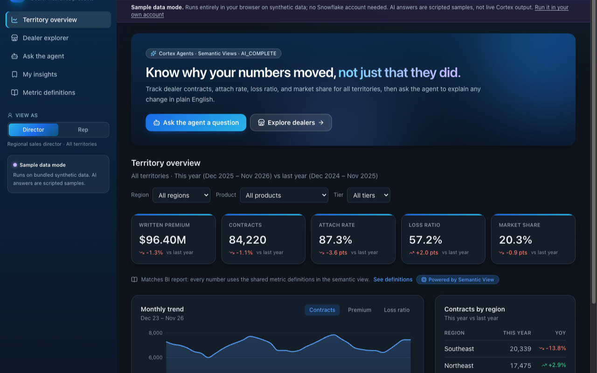

# Insurance Sales Performance Agent

Help insurance sales teams explain loss ratios, dealer performance, and market share in plain English, alongside the reports they already use.

**[Try the example in your browser](https://sfc-gh-ooral.github.io/sfguide-insurance-sales-agent/try/)** (no account needed) · **[Guide](https://sfc-gh-ooral.github.io/sfguide-insurance-sales-agent/)**

> **Synthetic data, illustrative logic.** Every dealer, rep, and number is invented by a seeded generator. This is an example, not production software, and not regulatory, actuarial, or compliance advice. The agent explains data; people make decisions.

Field reps who sell vehicle service contracts (VSC), GAP, tire & wheel, appearance, and key replacement products through car dealers get static BI reports that show *what* changed. This example adds a "why" layer on top of those reports:

| Screen | What a rep can do | Snowflake capability |
|---|---|---|
| Territory overview | KPIs with year-over-year deltas (written premium, contracts, attach rate, loss ratio, market share), a trend, and contracts by region. A "Matches BI report" link opens the shared metric definitions. | Semantic view |
| Dealer explorer | Sort and filter dealers, see 12-month sparklines, and rank the biggest gainers and decliners on the Movers tab. | Semantic view metrics, row access policy |
| Dealer detail | Product mix, attach-rate trend, claim causes, and loss ratio split into frequency × severity. Generate a visit prep brief. | AI_COMPLETE |
| Ask the agent | Ask "why" questions. Each answer shows a chart, the SQL used, and a *Verified query* badge when it matched a reviewed query. | Cortex Agents + Cortex Analyst, verified queries |
| My insights | Pin answers and briefs, add notes, choose what to include, and export a visit brief (Markdown or print). The agent never takes action on its own. | — (human in the loop) |

A **View as** switch toggles between a regional sales director (all territories) and a field rep (one territory). In live mode it changes the Snowflake role, so a row access policy, not app code, decides what the rep sees.



## Prerequisites

| Item | Requirement |
|---|---|
| Snowflake edition | **Enterprise or higher** for the row access policy. On Standard Edition, remove section 3 of `sql/setup.sql`; everything else works and the rep view shows all dealers. |
| Region / models | Cortex AI functions and Cortex Agents available in your region, or [cross-region inference](https://docs.snowflake.com/en/user-guide/snowflake-cortex/cross-region-inference) enabled. The visit brief uses `claude-sonnet-4-5` by default (change `SNOWFLAKE_BRIEF_MODEL`). |
| Role for setup | `ACCOUNTADMIN`, or a role that can create a database, warehouse, and roles and grant `SNOWFLAKE.CORTEX_USER`. |
| Feature status | All features used are generally available: semantic views with verified queries, Cortex Agents, AI_COMPLETE, row access policies. No preview features. |
| Local tools | Node.js 20+ and npm. For live mode, [Snowflake CLI](https://docs.snowflake.com/en/developer-guide/snowflake-cli/index) (`snow`) to run setup with file upload. |
| Tested with | Snowflake CLI 3.11, Node.js 20.12, Next.js 16.3, snowflake-sdk 3.4, on an AWS US account, November 2026. |

## Quick start: sample-data mode (no account)

```bash
git clone https://github.com/sfc-gh-ooral/sfguide-insurance-sales-agent
cd sfguide-insurance-sales-agent
npm install
npm run dev        # http://localhost:3000
```

Without `.env.local`, the app computes every screen from the bundled synthetic data (`data/mock/dataset.json`). Agent answers and visit briefs are scripted from the same numbers and labeled **Sample AI response**. Sample AI calls wait 4 to 7 seconds and show the same progress steps the live path runs (row access policy, Cortex Agent, Cortex Analyst SQL, warehouse query, AI_COMPLETE), marked as simulated time, so the example feels like the live app.

A **Sample / Live** switch in the header always shows which mode is on. Picking Live without a connection shows the setup steps below instead of switching; the app never asks for credentials in the browser.

## Live mode: run it in your Snowflake account

1. **Generate the load files** (written to `data/csv/`, git-ignored):
   ```bash
   npm run generate
   ```
2. **Run setup** from the repository root. It runs top to bottom with no edits, and the `PUT` commands upload the CSV files:
   ```bash
   snow sql -f sql/setup.sql -c <your_connection>
   ```
   In a Snowsight worksheet instead: run the script up to the `PUT` block, upload `data/csv/*.csv` to `@INSURANCE_SALES_DB.SALES.LOAD_STAGE` with the stage upload UI, then run the rest.
3. **Set up key-pair authentication** for your user (see comments in `.env.example`), keeping the private key outside the repository.
4. **Configure and start the app:**
   ```bash
   cp .env.example .env.local      # set SNOWFLAKE_ACCOUNT, SNOWFLAKE_USERNAME, SNOWFLAKE_PRIVATE_KEY_PATH
   npm run dev
   ```
   The header switch defaults to **Live** once a connection is configured (you can still pick Sample), the sidebar shows **Live: Snowflake**, and each AI answer reports its measured latency. A failed live call shows the error; it never falls back to sample data. "View as: Director" uses `INSURANCE_SALES_DEMO_ROLE`; "View as: Rep" uses `INSURANCE_SALES_REP_ROLE`. Setup grants both roles to the user who ran it.
5. **Optional check:** with the app running, `node scripts/check-live.mjs` asks the agent the suggested questions as both personas and generates two visit briefs.

To remove everything: `snow sql -f sql/cleanup.sql -c <your_connection>`.

### Objects created

| Object | Name | Notes |
|---|---|---|
| Warehouse | `INSURANCE_SALES_WH` | XSMALL, `AUTO_SUSPEND = 60`, initially suspended |
| Database / schema | `INSURANCE_SALES_DB.SALES` | Everything below lives here |
| Tables | `REPS`, `DEALERS`, `PRODUCTS`, `CONTRACTS_SOLD`, `CLAIMS`, `DEALER_FINANCED_DEALS`, `MARKET_BENCHMARKS`, `METRIC_DEFINITIONS`, `TERRITORY_ACCESS` | Synthetic data; ~251K contracts, ~59K claims |
| Views | `DEALER_PRODUCT_MONTHLY`, `CLAIM_CAUSES_MONTHLY`, `MARKET_SHARE_MONTHLY` | Monthly grain so every metric aggregates consistently |
| Stage / file format | `LOAD_STAGE`, `CSV_FF` | For the CSV load |
| Row access policy | `TERRITORY_POLICY` on `DEALERS.TERRITORY` | Rep role sees only the Southeast Inland territory |
| Semantic view | `INSURANCE_SALES_SV` | Metrics, synonyms, AI SQL-generation instructions, 10 verified queries |
| Cortex Agent | `INSURANCE_SALES_AGENT` | Cortex Analyst tool over the semantic view, runs on `INSURANCE_SALES_WH` |
| Roles | `INSURANCE_SALES_DEMO_ROLE` (director), `INSURANCE_SALES_REP_ROLE` (rep) | Least privilege: usage on the warehouse, database, schema, and agent; `SELECT` on the tables, views, and semantic view; `SNOWFLAKE.CORTEX_USER`. Neither role owns anything. |

`sql/cleanup.sql` drops the database (including the agent, semantic view, and policy), the warehouse, and both roles. It changes nothing else.

## Expected cost and time

Measured on our test account in November 2026. Your costs depend on your pricing and usage.

- **Setup:** `snow sql -f sql/setup.sql` ran top to bottom in about 40 seconds, including uploading ~14 MB of CSV files. The data load itself (7 `COPY` statements, ~251K + ~59K rows) took about 12 seconds of XSMALL warehouse time.
- **Warehouse:** about 0.38 credits for the whole build-and-test session, including many reruns of setup. The warehouse suspends after 60 seconds idle.
- **Cortex Agent:** about 1.53 credits for 21 agent questions in our test (about 0.07 per question). See `SNOWFLAKE.ACCOUNT_USAGE.CORTEX_AGENT_USAGE_HISTORY` for your own figures.
- **AI_COMPLETE visit briefs:** one call per brief (a short prompt plus about 200 words of output), billed by model token rates.
- **Sample-data mode and the hosted example:** no Snowflake cost.

## Verified query check

Measured on this synthetic data set in November 2026. Treat it as a starting point for your own evaluation, not an accuracy guarantee.

- **Through the agent:** all five suggested questions were answered with `verified_query_used = true`, for both the director and rep roles.
- **Cortex Analyst against the 10 verified questions:** we ran `evaluate` on the semantic view's YAML. Every verified query executed, and Analyst generated SQL for every question. The tool's automatic LLM judge didn't run in our account (its judge model wasn't available), so we compared the SQL by hand: **9 equivalent, 1 close.** The close one ("dealer areas with unusual tire & wheel claims") used a six-month window shifted one month earlier.
- **What the evaluation changed:** three AI SQL-generation instructions in the semantic view (a $20K premium floor when ranking dealers by loss ratio, "groups" are `DEALER_GROUP`, and "areas" are 3-digit ZIP), plus logical columns for every primary key, which Cortex Analyst requires.

## Known limitations

- **Loss ratio is simplified.** It is claims paid in a period ÷ premium written in the same period, a common sales-reporting view, not an earned-premium actuarial measure. Dealers whose volume collapses show very high loss ratios from run-off (claims on earlier contracts), which the agent and briefs call out.
- **Attach rate across all products can exceed 100%**, because one financed deal can carry several products. Per product, it stays below 100%.
- **Sample-data mode is scripted.** It answers the five suggested questions only, and the briefs follow a template. Live mode accepts any question.
- **One rep persona.** The row access policy maps one role to one territory (`TERRITORY_ACCESS`). Production use would map users or roles to territories from your CRM.
- **Market share** is state × product × month against a synthetic benchmark table. Reps only see share for the states their dealers are in.
- **My insights** is stored in the browser (`localStorage`), not in Snowflake.
- **The agent can be slow**: 10–20 seconds per question in our test.

## Customize with Cortex Code

Open this repository in Cortex Code and try:

- "Map this semantic view to my sales and claims tables. Keep metric names identical to my BI definitions and show me any gaps."
- "Add verified queries from my top 20 BI report questions and evaluate the agent against them."
- "Add a row access policy so each rep only sees their dealers, and test it with the View-as switcher."

## How it's built

```text
app/                  Next.js App Router pages and one API route (app/api/[op])
components/           Shell (nav + View as), charts, UI primitives
lib/sales-data.ts     Data interface shared by both modes
lib/mock-source.ts    Sample-data mode: computes screens from data/mock/dataset.json
lib/snowflake.ts      Live mode: bind-variable queries, DATA_AGENT_RUN, AI_COMPLETE
lib/verified-queries.ts  The verified-query SQL, extracted from sql/setup.sql
scripts/generate-data.mjs   Seeded synthetic data generator (CSV + mock JSON)
scripts/build-hosted-example.mjs  Static export to docs/try/ (npm run build:example)
sql/setup.sql, sql/cleanup.sql
data/README.md        Tables, metric definitions, and the planted stories
docs/                 GitHub Pages guide, screenshots, and the hosted example
```

The planted stories, such as the Southeast decline and the Georgia GAP severity spike, are documented with their numbers in [`data/README.md`](data/README.md).

## License and disclaimer

Licensed under the [Apache License 2.0](LICENSE).

This is an illustrative example provided as-is. It is not an official Snowflake product and is not supported by Snowflake Support. It contains no customer data. Review and test before any production use.

Owner: Oz Oral · Last reviewed: November 2026
